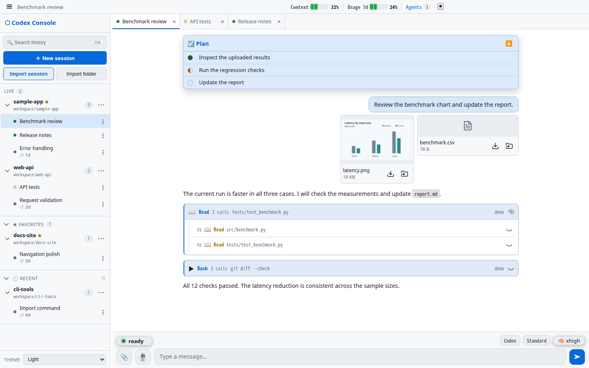
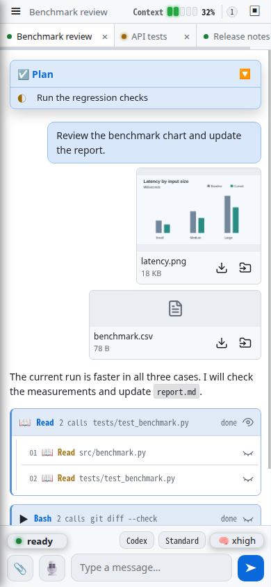

# Codex Console

English | [简体中文](README.zh-CN.md)

A browser interface for the OpenAI Codex CLI. It runs `codex app-server`, keeps
Codex sessions alive in the background, and presents conversation, tool calls,
plans, file changes, and session state in one interface.

<p align="center">
  
  
</p>

## Features

- **Streaming chat** with rendered Markdown and KaTeX math.
- **Inline result images** in assistant replies, with enlarged preview and download.
  Supports PNG, JPEG, GIF, and WebP files up to 5 MiB under the server user's home directory.
- **Tool activity cards** for shell commands, reads, searches, patches, MCP
  tools, and web searches. Consecutive calls of the same tool are grouped and
  can be expanded without losing individual inputs or outputs.
- **Changes drawer** with per-file edits and the current working-tree
  `git diff`.
- **Persistent sessions** backed by Codex rollout JSONL files under
  `~/.codex/sessions`.
- **Session tabs and sidebar** for keeping multiple sessions running and
  switching between projects without ending active work.
- **Projects library** with all stored main sessions grouped by folder, filtering,
  and named collections. Add folders or sessions by drag-and-drop or menu.
- **New-session dialog** with directory browsing and folder creation, model,
  reasoning effort, and permission settings.
- **History search, import, and export** for Codex rollout transcripts.
- **Pinned Plan dock** that updates in place, supports collapse, and clears
  after all tasks complete.
- **Subagents side panel** with per-session status, tasks, recent tools and
  expandable output. On wide windows it stays beside the main conversation.
- **Background terminals** with a command list and individual stop controls.
- **Approvals and questions** rendered as interactive controls, with a persistent pending-question panel for non-blocking questions.
- **Queued messages and steering** while a turn is running.
- **Image, text, and code attachments** from desktop or mobile. Images can also
  be pasted from the clipboard. Sent attachments have previews, device downloads,
  and a save-to-server option. Text and code are sent as bounded text input.
- **Optional local voice input** with live transcription and final correction
  before sending.
- **Model, reasoning effort, and speed controls** from the installed Codex
  app-server, applied to the next turn. New and resumed sessions start at
  Standard speed; Fast remains available when supported.
- **Page update notification** with draft-preserving reload.
- **Android client integration** with authenticated app-update downloads and
  task notifications for completed turns and pending questions or approvals.
- **Context and rate-limit meters** from Codex runtime data.
- **Local `/status` and `/compact` commands**.
- **Optional idle recap cards** generated after a configurable quiet period.
- **Optional local file links** through
  [web-file-manager](https://github.com/BoZhen/web-file-manager).
- **Multiple color themes** with a single-file frontend and no build step.

## Requirements

- Python 3
- [Tornado](https://www.tornadoweb.org/)
- An installed and authenticated OpenAI Codex CLI
- `zstd` on PATH for reading compressed `.jsonl.zst` history (plain JSONL needs no extra dependency)

Install the Python dependency:

```bash
python -m pip install tornado
```

Local voice transcription is optional. Install `faster-whisper` in the Python
runtime configured for the transcription worker; install `opencc` there as well
when Chinese script normalization is enabled. Browser microphone access requires
HTTPS or localhost. Live Chinese previews revise up to the latest 10 characters.

## Run

From the repository directory:

```bash
python codex_console.py
```

Open `http://127.0.0.1:7704`.

To listen on another interface, set an explicit bind address and enable
authentication:

```bash
CODEX_CONSOLE_BIND=0.0.0.0 \
CODEX_CONSOLE_AUTH=user:change-this-password \
python codex_console.py
```

## Configuration

| Environment variable | Default | Purpose |
|---|---:|---|
| `CODEX_CONSOLE_PORT` | `7704` | HTTP listen port |
| `CODEX_CONSOLE_BIND` | `127.0.0.1` | Listen address |
| `CODEX_CONSOLE_AUTH` | disabled | Optional HTTP Basic Auth as `user:pass` |
| `CODEX_CONSOLE_CODEX` | auto-detected | Path to the Codex executable |
| `CODEX_CONSOLE_WEBFM_URL` | same host, port `7701` | Base URL for local file links |
| `CODEX_CONSOLE_ANDROID_RELEASE_DIR` | `$XDG_DATA_HOME/codex-console/android` or `~/.local/share/codex-console/android` | Published Android client updates |
| `CODEX_CONSOLE_ATTACHMENT_DIR` | `$XDG_DATA_HOME/codex-console/attachments` or `~/.local/share/codex-console/attachments` | Private copies of sent attachments |
| `CODEX_CONSOLE_IMPORT_MAX_MB` | `1024` | Maximum transcript import size |
| `CODEX_CONSOLE_RECAP` | `0` | Enable idle recap cards |
| `CODEX_CONSOLE_RECAP_IDLE_SEC` | `300` | Idle time before recap generation |
| `CODEX_CONSOLE_RECAP_MODEL` | `gpt-5.3-codex-spark` | Recap model |
| `CODEX_CONSOLE_RECAP_TIMEOUT_SEC` | `45` | Recap timeout |
| `CODEX_CONSOLE_ITEM_HISTORY_LIMIT` | `256` | Completed live-item records retained per session |
| `CODEX_CONSOLE_TRANSCRIBE` | `0` | Enable local voice transcription |
| `CODEX_CONSOLE_TRANSCRIBE_PYTHON` | current Python | Python executable containing `faster-whisper` |
| `CODEX_CONSOLE_TRANSCRIBE_MODEL` | unset | Local CTranslate2 model directory or model identifier |
| `CODEX_CONSOLE_TRANSCRIBE_DEVICE` | `auto` | CTranslate2 device, such as `cpu` or `cuda` |
| `CODEX_CONSOLE_TRANSCRIBE_DEVICE_INDEX` | `0` | GPU index used by the worker |
| `CODEX_CONSOLE_TRANSCRIBE_COMPUTE_TYPE` | `default` | CTranslate2 compute type, such as `float16` or `int8` |
| `CODEX_CONSOLE_TRANSCRIBE_LANGUAGE` | auto | Optional fixed transcription language |
| `CODEX_CONSOLE_TRANSCRIBE_ALLOWED_LANGUAGES` | unrestricted | Comma-separated auto-detection allowlist, such as `zh,en` |
| `CODEX_CONSOLE_TRANSCRIBE_CHINESE_CONVERSION` | `none` | Chinese conversion: `none`, `t2s`, or `tw2sp` |
| `CODEX_CONSOLE_TRANSCRIBE_PAUSE_PUNCTUATION` | `0` | Add pause punctuation (comma at 0.5s, period at 1.2s) and infer final punctuation |
| `CODEX_CONSOLE_TRANSCRIBE_LD_LIBRARY_PATH` | unset | Additional CUDA library directories for the worker |
| `CODEX_CONSOLE_TRANSCRIBE_MAX_MB` | `16` | Maximum audio upload size |
| `CODEX_CONSOLE_TRANSCRIBE_MAX_SEC` | `120` | Maximum browser recording duration |
| `CODEX_CONSOLE_TRANSCRIBE_TIMEOUT_SEC` | `180` | Transcription request timeout |
| `CODEX_CONSOLE_TRANSCRIBE_IDLE_SEC` | `600` | Worker idle time before releasing model memory |

## Data

- Codex rollout transcripts: `~/.codex/sessions`
- Console session preferences and names: `~/.codex/console-*.json`
- Named project collections: `~/.codex/console-project-groups.json`. Removing a
  collection or its members does not move or delete transcripts or folders.
- History search index: `~/.cache/codex-console/history.db`

Before sending, attachment bodies remain in browser memory. Sent text and code
attachments become part of the Codex turn and may be stored in its rollout
JSONL. New uploads also have private server-side copies: original image bytes and
UTF-8 text/code. These copies survive service restarts and are not automatically
deleted. Removing them does not remove content already recorded in Codex rollouts.
Save-to-server copies are restricted to the home directory and never overwrite
existing files. Every live voice preview and final correction uses a
permission-restricted temporary file that is deleted after transcription;
transcribed text enters Codex only after the user sends the edited draft.

## Security

Codex Console can expose agent transcripts, source diffs, and command execution
inside selected project directories. The default bind address is loopback and
authentication is disabled. When making the service reachable from another
device, enable `CODEX_CONSOLE_AUTH` and place it behind a trusted network or an
authenticated TLS reverse proxy.

For private overlay networks such as Nebula or Tailscale, bind the service to
that network interface instead of `0.0.0.0`. When the network provides an HTTPS
or reverse-proxy publishing feature, keep Codex Console bound to loopback and
publish it through that feature.

## Implementation Notes

- The server and inline frontend live in `codex_console.py`; optional local
  transcription runs in the isolated `faster_whisper_worker.py` process.
- KaTeX is vendored under `static/katex` for offline math rendering.
- Codex Console prefers the native Codex executable installed with the npm
  package and accepts an explicit override through `CODEX_CONSOLE_CODEX`.

## License

[MIT](LICENSE)

The bundled Microsoft Fluent Emoji microphone asset retains its upstream MIT
license; see [the asset license](static/icons/fluentui-emoji-LICENSE.txt).
